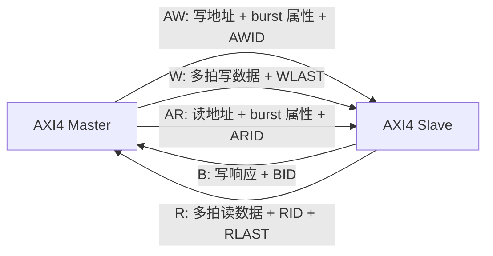
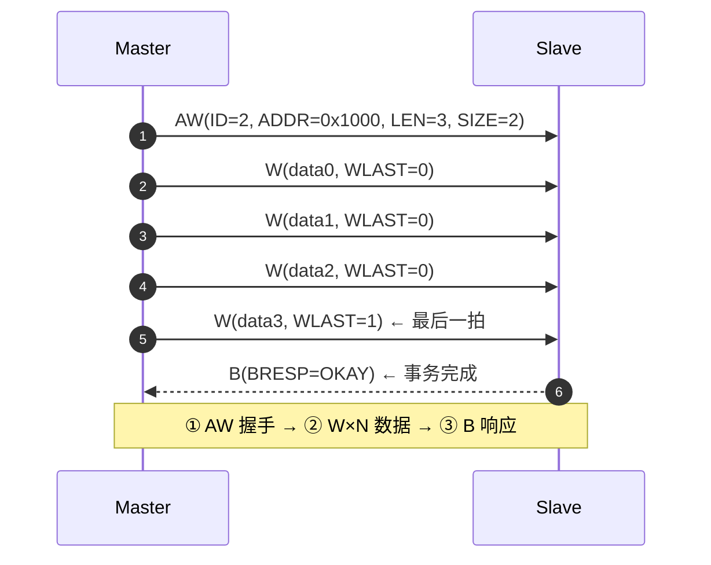
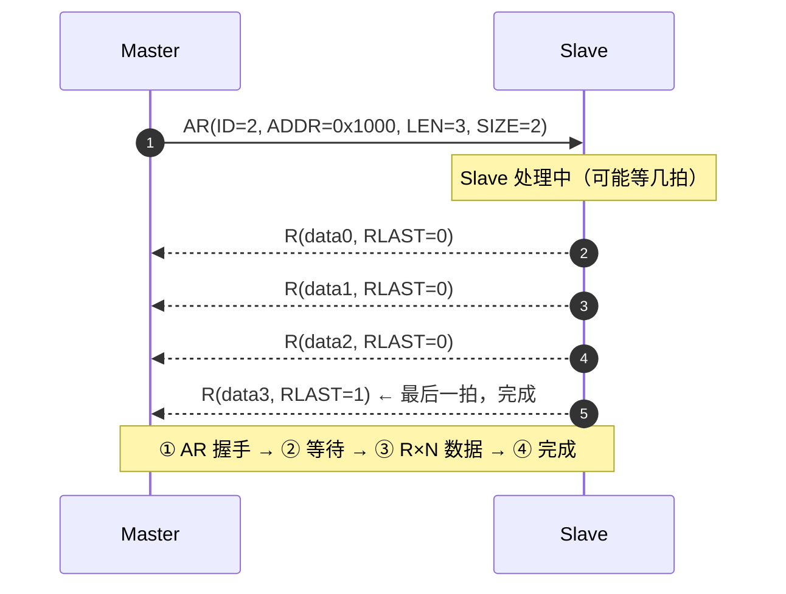
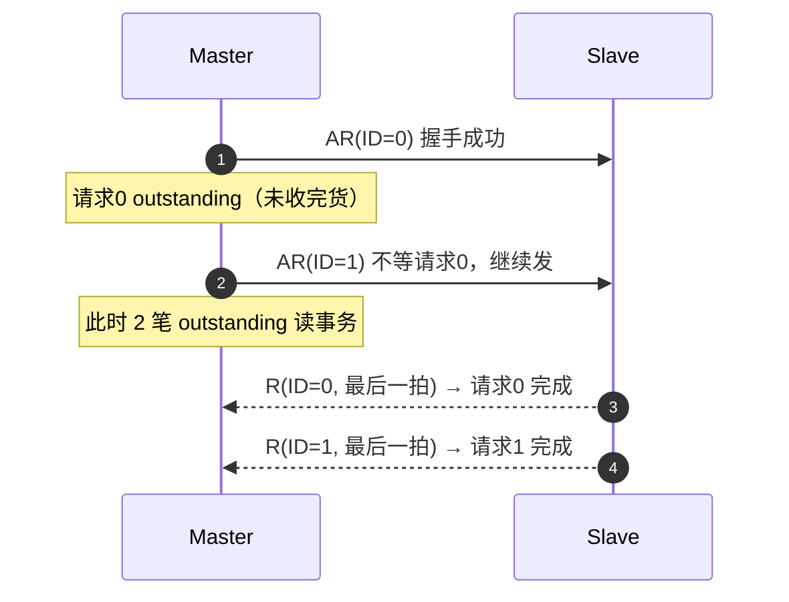
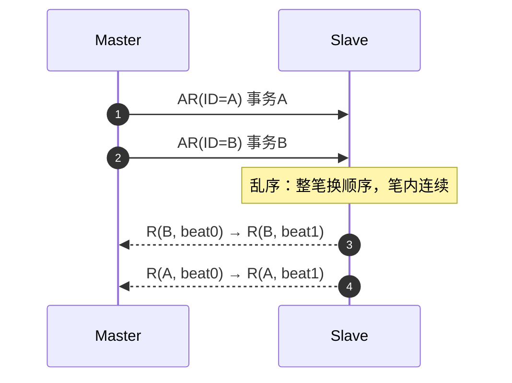
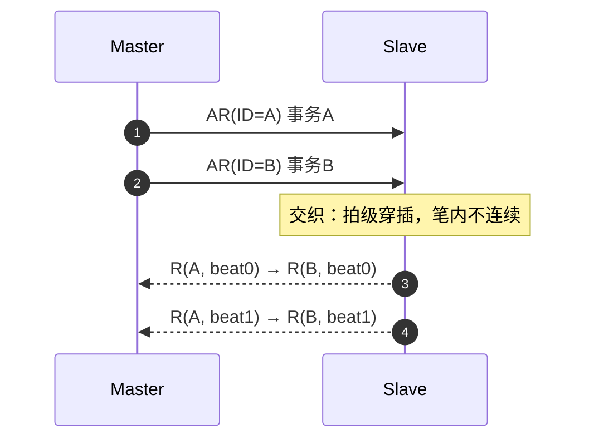

# AMBA AXI4 学习笔记：Burst、ID、Outstanding 与顺序模型

一次 AXI4 burst 用一个地址请求指定一组数据拍。看波形时，可以用 `AxLEN` 判断有几拍，用 `AxSIZE` 和 burst 类型推算地址，再按 ID 跟踪尚未完成的事务。

---

## 0. 协议版本与术语

本文讨论 AMBA 4 AXI4。协议定义以 ARM IHI 0022H 的 AXI4 章节为准，握手和 burst 示例可参阅 Arm《Introduction to AMBA AXI4》。IHI 0022 Issue L 用于对照新版术语，其中的 AXI5 专属功能应按对应版本查阅。

文中用 Master 指发起读写事务的一方，Slave 指响应方。新版资料也使用 Manager 和 Subordinate。

**事务与传输拍**

| 术语 | 含义 |
|---|---|
| Transaction | 完整读或写事务 |
| Transfer / Beat | 一次通道握手传输的数据单元 |

---

## 1. AXI4 解决什么问题

AXI4 面向高带宽、低延迟、高频率的片上互连。

与 APB/AXI4-Lite 相比，它增加的核心能力可以归纳为 **3 个词**：

- **Burst**：一个地址请求对应多个 data beat（发 1 次地址，连传多拍）。
- **ID**：区分多个逻辑事务（订单号）。
- **Multiple outstanding + 乱序**：前一笔未完成时可以继续发请求，不同 ID 可以乱序完成。

典型用途：

- CPU 与 DDR 控制器。
- DMA 与系统内存。
- 高性能加速器读写共享存储器。
- NoC/interconnect 内部的 memory-mapped 通路。

### 1.1 为什么需要 burst？（AXI-Lite 慢的本质）

**AXI-Lite 慢 ≠ 每拍传得少。** AXI-Lite 每拍 = 整个数据总线宽度（32 位 = 4 字节、64 位 = 8 字节）。慢在**每一笔都重复发地址（AW/AR）+ 收响应（B/R）**——地址和响应是"空转开销"：

```text
笔1: [发地址] [传4B] [收响应]
笔2: [发地址] [传4B] [收响应]   ← 地址响应重复几百次！
```

**burst 用"1 地址换 N 拍"把开销摊薄**：

```text
笔1: [发地址] [4B][4B]...[共256拍] [收响应]   ← 一次传 2KB
```

### 1.2 AXI 定义的是接口协议

AXI 定义的是两个接口之间的信号和时序，不规定 interconnect 内部必须使用总线、crossbar 还是 NoC。

```text
Master interface <--- AXI point-to-point ---> Slave interface
```

多 Master、多 Slave 系统需要 interconnect 完成：

- 地址译码。
- 仲裁。
- 路由。
- ID 扩展和返回路由。
- 宽度/协议转换。
- 缓冲和时序切分。

---

## 2. Transfer 与 Transaction

### 2.1 Transfer / Beat

一个通道上发生一次 `VALID && READY` 握手，就是一次 transfer（拍）。

例如：

```systemverilog
// [1] 只有在这个 ACLK 上升沿同时采到 RVALID 和 RREADY，
// [2] Master 才真正消费一个 read data beat。
r_fire = RVALID && RREADY;
```

每个 `r_fire` 表示接收一个 read data beat。

### 2.2 Transaction

完整写事务：

```text
1 个 AW transfer
+ N 个 W transfers
+ 1 个 B transfer
```

完整读事务：

```text
1 个 AR transfer
+ N 个 R transfers
```

其中 `N = AxLEN + 1`。

统计 outstanding 时按事务计数。一笔 burst 只占一笔 transaction，其中可以包含一个或多个数据拍。

---

## 3. 五通道与信号



每个通道独立握手：

```text
AWVALID/AWREADY
WVALID/WREADY
BVALID/BREADY
ARVALID/ARREADY
RVALID/RREADY
```

所有 AXI4-Lite 的握手规则在 AXI4 中仍成立：

1. 只在 `VALID && READY` 的上升沿发生 transfer。
2. Source 不得等待 READY 才拉 VALID。
3. VALID 拉高后必须保持到握手。
4. 阻塞期间 payload 必须稳定。
5. 接口输入和输出之间不能有组合路径。

### 3.1 AW/AR 地址通道共有字段

`Ax` 表示 `AW` 或 `AR`：

| 信号 | 作用 |
|---|---|
| `AxID` | 事务 ID |
| `AxADDR` | burst 第一个 transfer 的字节地址 |
| `AxLEN` | burst beat 数减 1 |
| `AxSIZE` | 每个 beat 的最大字节数，`bytes = 2^AxSIZE` |
| `AxBURST` | FIXED、INCR 或 WRAP |
| `AxLOCK` | exclusive access 属性 |
| `AxCACHE` | memory/cache 属性 |
| `AxPROT` | 特权、安全、指令/数据属性 |
| `AxQOS` | QoS 标识 |
| `AxREGION` | 同一物理接口中的逻辑区域 |
| `AxUSER` | 用户自定义 sideband |
| `AxVALID/AxREADY` | 地址通道握手 |

### 3.2 W 通道

| 信号 | 作用 |
|---|---|
| `WDATA` | 写数据 |
| `WSTRB` | 每字节写使能 |
| `WLAST` | 当前 beat 是 burst 最后一拍 |
| `WUSER` | 用户 sideband |
| `WVALID/WREADY` | 写数据握手 |

**AXI4 没有 `WID`。** 写数据必须按写地址事务的发出顺序出现（这是与读通道最大的不对称）。

### 3.3 B 通道

| 信号 | 作用 |
|---|---|
| `BID` | 对应写事务 ID |
| `BRESP` | 写响应 |
| `BUSER` | 用户 sideband |
| `BVALID/BREADY` | 写响应握手 |

### 3.4 R 通道

| 信号 | 作用 |
|---|---|
| `RID` | 对应读事务 ID |
| `RDATA` | 读数据 |
| `RRESP` | 每个 read beat 的响应 |
| `RLAST` | 当前 beat 是该读 burst 最后一拍 |
| `RUSER` | 用户 sideband |
| `RVALID/RREADY` | 读数据握手 |

---

## 4. Burst 三要素

描述一个普通 AXI4 burst，至少先看：

```text
AxADDR  起始地址
AxLEN   一共有多少 beat（拍数减 1）
AxSIZE  每个 beat 最多多少字节
AxBURST 地址如何变化
```

| 参数 | 类比 |
|---|---|
| AxLEN | 搬几个箱子 |
| AxSIZE | 每个箱子多大 |
| AxBURST | 箱子怎么摆 |

### 4.1 `AxLEN`

```systemverilog
// [1] AxLEN 使用"拍数减 1"编码，所以 8'h00 代表 1 beat，8'hFF 代表 256 beats。
beats = AxLEN + 1;
```

**为什么 +1？** 因为 0 也要能表示"传 1 拍"。

例子：

| `AxLEN` | beat 数 |
|---:|---:|
| 0 | 1 |
| 3 | 4 |
| 15 | 16 |
| 255 | 256 |

**AXI4 的 AxLEN 是 8 位（0~255，最多 256 拍）**；AXI3 只有 4 位（最多 16 拍）——这是 AXI3 vs AXI4 的考点之一。

AXI4 中：

- INCR burst 最多 256 beat。
- FIXED burst 最多 16 beat。
- WRAP burst 只能是 2、4、8、16 beat。

**为什么限制不同？** FIXED 地址不变、反复操作同一位置有副作用，限制防止滥用；INCR 是最规矩的访问，放最宽；WRAP 的"环"要求长度是 2 的幂，回绕边界才能对齐。

### 4.2 `AxSIZE`

```systemverilog
// [1] 左移等价于 2^AxSIZE：SIZE=0/1/2/3 分别表示 1/2/4/8 bytes。
bytes_per_beat = 1 << AxSIZE;
```

| `AxSIZE` | 每 beat 最大字节数 |
|---|---:|
| `3'b000` | 1 |
| `3'b001` | 2 |
| `3'b010` | 4 |
| `3'b011` | 8 |
| `3'b100` | 16 |
| `3'b101` | 32 |
| `3'b110` | 64 |
| `3'b111` | 128 |

`AxSIZE` 不能超过接口数据总线宽度。

**注意字节和位的换算**：64-bit 总线 = 8 字节（64÷8），最大合法 `AxSIZE=3`（2³=8 字节）。**AxSIZE 是"字节数取 2 的对数"，不是位数。**

| 总线宽度 | 字节数 | AxSIZE 合法上限 |
|---|---|---|
| 32 位 | 4 B | 2（2²=4） |
| 64 位 | 8 B | 3（2³=8） |
| 128 位 | 16 B | 4 |

### 4.3 `AxBURST`

| 编码 | 类型 | 地址行为 | 常见用途 |
|---|---|---|---|
| `2'b00` | FIXED | 每 beat 地址相同 | FIFO 端口（自动售货机：同一按钮，内容不同） |
| `2'b01` | INCR | 每 beat 按 size 增加 | 普通连续内存（门牌号） |
| `2'b10` | WRAP | 达到边界后回绕 | cache line fill（旋转寿司） |
| `2'b11` | Reserved | 不允许 | - |

**三种类型对比**（同一参数：4 拍、每拍 4 字节、起始 0x1008）：

```text
FIXED:  0x1008 → 0x1008 → 0x1008 → 0x1008   （地址不变）
INCR:   0x1008 → 0x100C → 0x1010 → 0x1014   （每拍 +4）
WRAP:   0x1008 → 0x100C → 0x1000 → 0x1004   （到 16 字节边界回绕）
```

**WRAP 为什么回绕？** 4 拍 × 4 字节 = 16 字节是一个"环"（0x1000~0x100F），走到底就绕回环头。cache 用 WRAP 实现 critical-word-first 填充：先传 CPU 要的字，再回绕补齐整行。

---

## 5. Burst 地址计算

定义：

```text
Start_Address   = AxADDR
Number_Bytes    = 2^AxSIZE
Burst_Length    = AxLEN + 1
Aligned_Address = floor(Start_Address / Number_Bytes) * Number_Bytes
```

**地址序列**：

```text
Address_1 = Start_Address（首拍用原始地址）
Address_N = Aligned_Address + (N-1) × Number_Bytes（第 N 拍，N≥2）
```

### 5.1 INCR burst

第一拍地址就是 `Start_Address`。后续 beat 按 `Number_Bytes` 递增，非对齐首拍之后从对齐边界继续。

例 1（对齐起点）：

```text
64-bit data bus
AxADDR  = 0x1008
AxSIZE  = 2  -> 4 bytes/beat
AxLEN   = 3  -> 4 beats
AxBURST = INCR

拍1: 0x1008
拍2: 0x100C
拍3: 0x1010
拍4: 0x1014
```

例 2（非对齐起点）：

```text
64-bit data bus
AxADDR  = 0x1003
AxSIZE  = 2  -> 4 bytes/beat
AxLEN   = 3  -> 4 beats
AxBURST = INCR

Number_Bytes = 4
Aligned_Address = floor(0x1003 / 4) * 4 = 0x1000

拍1: 0x1003   ← 非对齐首拍，用原始地址
拍2: 0x1000 + 1×4 = 0x1004
拍3: 0x1000 + 2×4 = 0x1008
拍4: 0x1000 + 3×4 = 0x100C
```

有效 byte lane 还要结合数据总线宽度和 `WSTRB` 判断（见第 6 节）。

### 5.2 FIXED burst

```text
Address_N = Start_Address
```

每拍访问同一地址和同一组允许的 byte lane。常用于向 FIFO data register 连续 push/pop。

### 5.3 WRAP burst

限制：

- 起始地址必须对齐到每 beat 大小。
- beat 数只能为 2、4、8、16。

```text
total_bytes   = Number_Bytes * Burst_Length
wrap_boundary = floor(Start_Address / total_bytes) * total_bytes
upper_boundary = wrap_boundary + total_bytes
```

例：

```text
Start = 0x1C
Size  = 4 bytes
Len   = 4 beats
总范围 = 16 bytes
wrap boundary = 0x10
地址序列 = 0x1C, 0x10, 0x14, 0x18
```

### 5.4 4KB 边界规则

**一个 AXI burst 不能跨越 4KB 地址边界。**

```text
burst 的首地址和最后一个被访问的字节，必须在同一个 4KB 页内。
```

原因是 4KB 常是最小页或地址译码边界，跨越后可能落到不同 Slave 或不同属性区域。

常用检查：

```systemverilog
// [1] 这里只表达"首地址与最后一个被访问字节仍在同一 4KB 页"的思路。
// [2] 真正计算 end_addr 时必须考虑 burst 类型、长度、size、非对齐和 wrap 行为。
(start_addr[ADDR_WIDTH-1:12] == end_addr[ADDR_WIDTH-1:12])
```

**例**：`AxADDR=0x1FFC`，`AxSIZE=3`（8 字节），`AxLEN=3`（4 拍）→ 覆盖 0x1FFC~0x2003，末地址 0x2003 的页号（[31:12]=0x2）与首地址（0x1）不同 → **跨越 0x2000 边界，非法**。

---

## 6. 非对齐传输与 byte lane

### 6.1 非对齐的含义

若 `AxADDR` 不是 `2^AxSIZE` 的整数倍，就是非对齐起始地址。

例如：

```text
AxSIZE=2 -> 每 beat 最多 4 bytes
自然对齐地址低 2 位应为 00
AxADDR=0x1002 -> 非对齐
```

**非对齐只影响首拍**：首拍从原始地址开始，只使用部分字节；从第 2 拍起地址对齐，每拍传满 SIZE 字节。

### 6.2 byte lane 是什么

数据总线被分成 N 个字节的"车道"（lane），每个车道放 1 字节。64 位总线 = 8 个 lane：

```text
lane 7  lane 6  lane 5  lane 4  lane 3  lane 2  lane 1  lane 0
[63:56] [55:48] [47:40] [39:32] [31:24] [23:16] [15:8]  [7:0]
```

**地址怎么决定从哪个 lane 开始？** 地址低 log2(总线字节数) 位 = 本拍第一个字节所在的 lane 号（64 位总线看低 3 位，8 个 lane 绕一圈）。

### 6.3 非对齐首拍的有效字节（两个 mod 别混）

| 计算 | 用什么 | 例 0x1005 |
|---|---|---|
| **首拍有效字节数** = Number_Bytes - (addr mod Number_Bytes) | mod **SIZE(4)** | 4 - (0x1005 mod 4) = **3 字节** |
| **从哪个 lane 开始** = addr mod 总线字节数 | mod **总线(8)** | 0x1005 mod 8 = **5 → lane 5** |

**为什么？** 两个 mod 回答两个不同的问题：

- **mod SIZE**：协议层——burst 从第 2 拍起地址对齐到 SIZE，所以首拍只能覆盖"从起始地址到下一个 SIZE 对齐边界"的字节；
- **mod 总线字节数**：物理层——lane 是数据总线的固定车道，地址每 +1 往后挪一个车道，8 个车道绕一圈。

**完整示例**：64 位总线，`AxADDR=0x1005`，`AxSIZE=2`（4 字节），`AxLEN=3`（4 拍），INCR，写方向：

| 拍 | 地址 | 起点 lane | 有效 lane | WSTRB | 覆盖字节 |
|---|---|---|---|---|---|
| 拍1 | 0x1005 | lane 5 | lane 5~7 | `1110_0000` | 0x1005~0x1007 |
| 拍2 | 0x1008 | lane 0 | lane 0~3 | `0000_1111` | 0x1008~0x100B |
| 拍3 | 0x100C | lane 4 | lane 4~7 | `1111_0000` | 0x100C~0x100F |
| 拍4 | 0x1010 | lane 0 | lane 0~3 | `0000_1111` | 0x1010~0x1013 |

**验证无重叠**：总覆盖 0x1005~0x1013 = 15 字节 = 4拍×4B - 1（偏移）。每个字节恰好传一次，无重叠、无空洞。

### 6.4 写数据由 `WSTRB` 最终限定

`WSTRB[n]` 对应 `WDATA[8n +: 8]`。

Slave 只更新 strobe 为 1 的 byte lane。

关键检查：`WSTRB` 不能宣称本 beat 地址范围之外的 byte lane 有效。

### 6.5 窄传输

64-bit 数据总线上执行 32-bit transfer：

```text
data bus bytes = 8
AxSIZE = 2 -> 4 bytes/beat
```

根据地址低位，本 beat 使用低 4 个或高 4 个 byte lane。**数据总线宽不等于每拍一定传满整条总线**——每拍宽度由 `AxSIZE` 决定。

---

## 7. 写事务

> **完整写事务流程（三步走）：① AW 握手（1 拍）→ ② W 握手 ×N（数据拍，WLAST 标记最后）→ ③ B 握手（1 拍响应）。**

一次多拍写 burst 的完整示例：



```text
AW(ID=2, ADDR=0x1000, LEN=3, SIZE=2)   ← ① 地址握手，请求 4 拍数据
W(ID=2, data0, WLAST=0)                 ← ② 第 1 拍数据
W(ID=2, data1, WLAST=0)                 ← ② 第 2 拍数据
W(ID=2, data2, WLAST=0)                 ← ② 第 3 拍数据
W(ID=2, data3, WLAST=1)                 ← ② 第 4 拍（最后一拍）
B(ID=2, BRESP=OKAY)                     ← ③ 响应回来，事务完成
```

注意：**AXI4 的 W 通道没有 WID**（写数据按 AW 顺序归属）—— 这是与读通道最大的不对称。

### 7.1 AW 与 W 没有固定时序关系

合法情况：

```text
AW 在 W 前
W 在 AW 前
AW 与 W 同拍
```

interconnect 负责把地址和写数据重新对齐并路由到正确 Slave。

### 7.2 W beat 计数

每次：

```systemverilog
// [1] beat 计数、WLAST 检查和写数据入队都只能由 w_fire 触发，
// [2] WVALID 单独为 1 只表示 Source 正在等待 Receiver。
w_fire = WVALID && WREADY;
```

才增加已接收 beat 数。

期望：

```text
总 W fire 数 = AWLEN + 1
最后一个 W fire 时 WLAST=1
其他 W fire 时 WLAST=0
```

### 7.3 WLAST 与反压对齐

**WLAST=1 必须出现在"实际握手成功（WVALID && WREADY）"的最后一拍。** 若 Slave 反压（WREADY=0）拖了几拍，WLAST 要跟着往后挪——**WLAST 跟"实际传输的拍"对齐，不跟"名义拍号"对齐**。

**反压拖长的是周期数，不是拍数**：无论反压多少拍，实际握手永远是 LEN+1 次，WLAST 永远在第 LEN+1 次实际握手上。

示例（AWLEN=3，中间反压 2 拍）：

```text
拍2: W d0, WLAST=0   ← 第 1 次握手
拍3: W d1, WREADY=0  ← 反压第 1 拍（不算握手）
拍4: W d1, WREADY=0  ← 反压第 2 拍（不算握手）
拍5: W d1, WLAST=0   ← 第 2 次握手（补传成功）
拍6: W d2, WLAST=0   ← 第 3 次握手
拍7: W d3, WLAST=1   ← 第 4 次握手 = 最后一次 → WLAST=1
```

**为什么需要 WLAST？** 接收方（Slave 收 W）可能不知道或不想数拍数——WLAST 直接告诉它"结束了"。

### 7.4 B 响应依赖

AXI4 Slave 必须等以下条件都发生后才断言对应 `BVALID`：

- 写地址已握手。
- 最后一个写数据 beat 已握手，即 `WVALID && WREADY && WLAST`。

`BVALID` 出现不需要等待 `BREADY`。Slave 先给出响应，Master 决定何时接收。

### 7.5 写数据顺序

AXI4 没有 WID，Master 必须按照 AW 地址事务的顺序发送完整 W burst。

```text
AW(ID=3, burst A)
AW(ID=7, burst B)
W burst A 的全部 beats
W burst B 的全部 beats
```

不能把 A、B 的 W beats 交织（写交织 AXI4 不支持，AXI3 支持）。

### 7.6 写响应可以乱序吗

不同 ID 的写响应可以乱序返回，只要 Slave/interconnect 支持。

同一 ID、同一目标的响应必须保持请求顺序。

---

## 8. 读事务

> **完整读事务流程（四步走）：① AR 握手（1 拍）→ ② Slave 处理等待（可能几拍）→ ③ R 握手 ×N（数据拍，RLAST 标记最后）→ ④ 完成。**

一次多拍读 burst 的完整示例：



```text
AR(ID=2, ADDR=0x1000, LEN=3, SIZE=2)   ← ① 地址握手，请求 4 拍数据
...（Slave 处理中，可能等几拍）          ← ② 等待
R(ID=2, data0, RLAST=0)                 ← ③ 第 1 拍数据
R(ID=2, data1, RLAST=0)                 ← ③ 第 2 拍数据
R(ID=2, data2, RLAST=0)                 ← ③ 第 3 拍数据
R(ID=2, data3, RLAST=1)                 ← ③ 第 4 拍（最后一拍）→ ④ 完成
```

**关键**：R 通道每个数据拍都带 **RID**（对应该请求）、**RRESP**（该拍状态）、**RLAST**（最后一拍标记）——即使拍被乱序/交织打乱，Master 也能靠 RID + RLAST 重新拼装。

### 8.1 AR 请求

一次 AR handshake 携带完整 burst 描述：

```text
ARID, ARADDR, ARLEN, ARSIZE, ARBURST, attributes
```

### 8.2 R 返回

每个 read beat 都携带：

```text
RID + RDATA + RRESP + RLAST
```

每个 `RVALID && RREADY` 才消费一拍。

### 8.3 `RRESP` 是逐 beat 的

读 burst 的每一个 beat 都有 `RRESP`。不同 beat 可以出现不同响应，不能只看最后一拍。

### 8.4 `RLAST`

对于 `ARLEN=N-1`：

```text
前 N-1 个已握手 R beat：RLAST=0
第 N 个已握手 R beat：RLAST=1
```

与写方向同理：**RLAST=1 必须出现在实际握手成功（RVALID && RREADY）的最后一拍**，Master 反压时（RREADY=0）RLAST 跟着往后挪。RLAST 与 WLAST 的作用相同——告诉接收方"burst 结束，准备收尾"。

### 8.5 读数据交织与乱序

不同 RID 的事务可以乱序完成。支持读交织的实现甚至可以在 beat 粒度交替返回不同 RID：

```text
R(ID=1, beat0)
R(ID=2, beat0)
R(ID=1, beat1, last)
R(ID=2, beat1, last)
```

但同一 ID 的事务返回顺序必须符合 ordering 规则。

---

## 9. Response 编码

| 编码 | 名称 | 含义 |
|---|---|---|
| `2'b00` | OKAY | 普通成功；也可表示 exclusive write 未成功更新 |
| `2'b01` | EXOKAY | exclusive access 成功 |
| `2'b10` | SLVERR | 已到达 Slave，但操作失败 |
| `2'b11` | DECERR | interconnect 无法译码到目标 |

### 9.1 `SLVERR` 与 `DECERR`

```text
DECERR：不知道该把请求送到哪里（地址映射空洞）
SLVERR：送到了某个 Slave，但它拒绝或执行失败
```

### 9.2 写响应与读响应粒度

```text
写：整个 burst 只有一个 BRESP
读：每个 data beat 都有一个 RRESP
```

**为什么？** 读数据是逐拍从 Slave 流出，每拍可独立报状态；写是整批送到，Slave 收完统一给结果。

**错误也必须保持协议完整**：即使某拍 SLVERR，剩余拍仍要传完、WLAST/RLAST 仍要对齐，不能中途断。

---

## 10. ID、Outstanding 与乱序

这是完整 AXI4 与 Lite 的核心差异。

### 10.1 Outstanding

地址请求已经握手、最终响应却还没回来，这笔事务就叫 outstanding。白话说，就是"已经下单，但还没有收完货"。

例如：



```text
AR(ID=0) 已握手，还没收到最后 R beat
Master 又发送 AR(ID=1)
```

此时有两笔 outstanding read transactions。

**outstanding 深度** = 系统里最多能同时挂多少笔未完成事务 = `min(Master 支持数, Slave 支持数)`——由硬件缓冲槽位决定，不是由 ID 数量决定（ID 决定"能不能区分"，缓冲决定"能挂几笔"）。

### 10.2 为什么需要 ID

如果返回顺序与请求不同，Master 需要知道每个响应属于哪笔请求。

ID 就像事务的编号（订单号）。不同编号可以并行处理和乱序返回；相同编号则提供必要的顺序约束。

```text
ARID -> RID
AWID -> BID
```

**同 ID 可以发多个事务，但必须按"先发先回"配对**——因为 ID 相同就无法区分，顺序是唯一的配对机制；不同 ID 靠编号区分，可以乱序。

### 10.3 基本顺序保证

同一通道、同一 ID、同一目标的事务按序。

协议通常不自动保证以下情况之间的顺序：

- 不同 Master。
- 读与写之间。
- 不同 ID。
- 不同目标区域。
- 不同 memory location。

若软件/硬件算法需要额外顺序，Master 必须等待前一事务响应，或使用架构规定的 barrier/同步机制。

### 10.4 ID 不是地址

ID 表示逻辑事务流，不用于地址译码。相同 ID 可以访问不同地址，不同 ID 也可以访问同一地址，但会影响可用的顺序保证和冲突处理。

### 10.5 Interconnect 扩展 ID

多 Master interconnect 常在原 ID 前附加 Master port 编号：

```text
{master_port, original_id}
```

返回时用附加位路由到正确 Master，再移除附加位。

### 10.6 乱序与交织的区别

**乱序（Out-of-Order）= 事务级重排**：整笔事务作为整体，谁先完成谁先回，每笔内部拍连续。



```text
请求: 事务A(2拍)  事务B(2拍)
乱序: R(B0) R(B1) R(A0) R(A1)   ← 整笔换顺序，笔内连续
```

**交织（Interleaving）= 拍级穿插**：不同 ID 的数据拍互相穿插，每笔内部拍不连续。



```text
交织: R(A0) R(B0) R(A1) R(B1)   ← 拍级穿插
```

| | 乱序 | 交织 |
|---|---|---|
| 重排单位 | 整笔事务 | 单个拍 |
| 笔内拍连续吗 | 连续 | 不连续 |
| 实现依据 | ID | 每拍带 RID + RLAST 拼装 |

**交织深度**：1 = 先收完一笔的拍才能收另一笔（= 不交织）；>1 = 可同时交替接收多笔。**AXI4 读支持交织、写不支持**（写无 WID 无法区分，AXI3 写支持）。

---

## 11. Ordering

### 11.1 "返回顺序"不等于"内存可见顺序"

收到 response，只说明接口协议已经走到规定的完成点；它不一定表示系统中所有处理器或设备已经看到这次写入。

AXI ordering model 还涉及：

- Memory location 与 Peripheral region。
- 事务何时被观察。
- Bufferable 属性。
- endpoint 前是否可以提前响应。

初学阶段先掌握接口级规则：

1. 同 ID 响应按请求顺序返回。
2. 不同 ID 可能乱序。
3. 读写之间没有天然顺序保证。
4. 需要强顺序时，不要仅靠"我先发了"。

因此，"先发请求"不等于"所有地方都先看到结果"。需要强顺序时，要等待响应或使用系统规定的 barrier/同步机制。

### 11.2 Peripheral region 为什么更敏感

外设寄存器访问可能有副作用，例如：

- 写 command 启动操作。
- 读 status 清中断。
- 访问一个地址影响另一个地址。

因此对外设访问的排序要求通常比普通内存更严格。

---

## 12. Exclusive Access

Exclusive access 用于实现 read-modify-write，而不是长时间锁住总线。

概念流程：

```text
1. Exclusive Read：读取位置，并让系统 monitor 记录地址/ID
2. 其他访问可能改变该位置
3. Exclusive Write：只有 monitor 条件仍成立才真正写入
```

响应：

- exclusive read 成功接受通常返回 `EXOKAY`。
- exclusive write 成功更新返回 `EXOKAY`。
- exclusive write 失败、不更新目标，返回 `OKAY`。

Master 看到 `OKAY` 不能把它当协议错误，而应理解为"条件写失败，需要重试算法"。

### 12.1 常见限制

Exclusive read/write 对必须保持关键属性匹配，例如 ID、地址、长度、大小、burst 类型等。具体实现还受 exclusive monitor 能力限制。

---

## 13. 地址属性

### 13.1 `AxPROT`

| 位 | `0` | `1` |
|---|---|---|
| `[0]` | Unprivileged | Privileged |
| `[1]` | Secure | Non-secure |
| `[2]` | Data | Instruction |

### 13.2 `AxCACHE`

`AxCACHE` 描述事务可否 buffer、可否修改以及 cache 分配提示。它会影响 interconnect 能否拆分、合并、提前响应或经过缓存。

查 `AxCACHE` 时，把各位的编码与项目 memory map 中相应地址区域的属性对照。

### 13.3 `AxQOS`

提供 QoS 标识，interconnect 可以据此仲裁，但协议不规定唯一的 QoS 算法。

### 13.4 `AxREGION`

让一个物理 Slave 接口表示多个逻辑区域，区域可以有不同内部行为或属性。

### 13.5 `AxUSER/xUSER`

用户自定义 sideband。只有系统双方明确约定含义时才有意义，通用 VIP 不应擅自解释。

---

## 参考资料

- Arm, *Introduction to AMBA AXI4*, 102202 Issue 01, 2020。
- Arm, *AMBA AXI and ACE Protocol Specification*, ARM IHI 0022H, Part A, 2020。
- Arm, *AMBA AXI Protocol Specification*, ARM IHI 0022 Issue L, 2025（用于通用架构与新版边界对照）。
